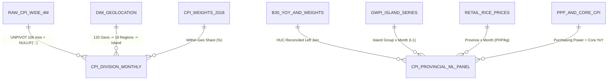

# PesoPulse: Forecasting Philippine Provincial Inflation & Supply-Shock Pass-Through

<div align="center">


-00695c?style=for-the-badge)


**Forecasting monthly inflation across 100 Philippine provinces/HUCs and NCR (18 regions, Jan 2018 – Oct 2026), measuring Bottom-30% inflation inequality, and simulating real-time rice, utility, and fuel price shocks.**

</div>

---

## 1. Research Objective & Stakeholder Scope

> **"What drives provincial inflation divergence across the Philippines, do upstream wholesale & rice prices predict next-month CPI surges, and how severely do food shocks hit the Bottom 30% of households?"**

Designed for **Bangko Sentral ng Pilipinas (BSP)** regional monetary monitoring, **NEDA/DEPDev** Regional Development Councils, and **DTI/DA** Local Price Coordinating Councils, **PesoPulse** transforms the `73.87 MB` PSA OpenSTAT monthly CPI release (`4,502,880` raw geolocation–commodity–month cells) inside **DuckDB** into an interactive subnational forecasting and "What-If" decision-support platform.

---

## 2. Verified Philippine Government Data Sources (PSA OpenSTAT `2M`)

All datasets originate from verified **Philippine Statistics Authority (PSA) OpenSTAT** tables (`openstat.psa.gov.ph`), ingested deterministically by `src/duckdb_pipeline.py`:

| Source / PSA PxWeb Table ID | Raw Artifact | Scope & Granularity |
| :--- | :--- | :--- |
| `2M/PI/CPI/2018NEW/0012M4ACP22.px` | `NOV 05/Consumer Price Index ... 2018 - 2026.csv` (`73.87 MB`) | Monthly CPI (`2018=100`) across `120` geolocations × `354` COICOP items, `Jan 2018 – Oct 2026` (`42,480` wide rows; `4,502,880` cells) |
| `2M/PI/CPI/2018NEW/0012M4ACP23.px` | `data/raw/psa_cpi_yoy_key_2019_2026.csv` (`230,400` rows) | Official PSA Year-on-Year Inflation (`%`) across `120` geolocations × key COICOP divisions (`Jan 2019 – Oct 2026`) |
| `2M/PI/CPI/2018NEW/0012M4ACP25.px` | `data/raw/psa_cpi_weights_2018.csv` (`42,480` rows) | Official `2018=100` CPI basket weights across all `120` geolocations × `354` items (normalized within-geo `%` in DuckDB) |
| `2M/PI/CPI/2018NEW/0012M4ACP24.px` | `data/raw/psa_ppp_2018_2026.csv` (`12,960` rows) | Monthly Purchasing Power of the Peso (`2018=100`) across `120` geolocations (`2018–2026 Oct`) |
| `2M/PI/CPI/2018NEW/0012M4ACP31.px` | `data/raw/psa_core_cpi_yoy_2019_2026.csv` (`1,632` rows) | National Core CPI YoY Inflation (`%`) excluding volatile food & energy (`2019–2026 Oct`) |
| `2M/PI/BIH/2018NEW/0022M4ABIR2.px` & `IR3.px` | `data/raw/psa_b30_yoy_2019_2026.csv` (`103,680` rows) & weights (`1,080` rows) | Bottom 30% Income Households CPI YoY (`%`) & basket weights across `120` geolocations (`2019–2026 Oct`) |
| `2M/PI/WPI/2012/0032M4AWPI1.px` | `data/raw/psa_gwpi_2018_2026.csv` (`1,296` rows) | General Wholesale Price Index (`2012=100`) for `Philippines`, `Luzon`, `Visayas`, `Mindanao` (`2018–2026 Sep`) |
| `2M/2018NEW/0042M4ARN01.px` | `data/raw/psa_retail_rice_2018_2026.csv` (`25,704` rows) | Provincial/Regional monthly retail prices (`PHP/kg`) for Well-Milled & Regular-Milled Rice (`2018–2026`) |

### Consolidated Schema Audit (`data/pipeline_audit.json`)
* **Master Provincial ML Panel (`data/cpi_provincial_ml_panel.parquet` / `.csv`)**: **`10,706`** monthly rows across **`101` subnational units** (`100` Provinces/HUCs + `NCR`), **`18` Philippine regions** (including **NIR** & **BARMM**), **`55` engineered columns**, spanning **`2018-01` to `2026-10`**.
* **YoY Predictive Sample (`2019–2026`)**: **`9,494`** subnational monthly records (`94` months × `101` units).
* **Division Decomposition Mart (`data/cpi_division_monthly.parquet`)**: **`254,082`** unpivoted key COICOP records (`1.36 MB` ZSTD Parquet) joining within-province weights (`%`) to YoY rates (`pp` contributions).
* **Honest Completeness Audit**: `1,212` rows lack Bottom-30% YoY because `2018` has no prior-year base (`0%` missing across `2019–2026` after HUC name reconciliation); `1,313` rows lack GWPI YoY (`2018` + `Oct 2026` lag); `212` rows lack retail rice quotes (`Sulu` / `2` island units).

---

## 3. DuckDB Relational Pipeline Architecture



---

## 4. Empirical Findings & Out-of-Time Model Benchmarks (`2025–2026` Holdout)

### Statistical Hypothesis Tests (`n = 9,494`)
1. **Significant Regional & Island Divergence (H1)**: Monthly inflation differs significantly across Luzon, Visayas, and Mindanao (`One-Way ANOVA F = 8.215`, `p = 2.72e-4`; `Kruskal-Wallis H = 27.876`) and across all 18 regions (`F = 5.530`, `p = 1.34e-12`). Mean provincial YoY = `3.95%` (`Median = 3.60%`, `SD = 2.85%`, `Skew = 0.50`, `Kurtosis = 3.25`, `Tukey Upper Fence = 11.25%`).
2. **Food Inflation Is Starkly Regressive (H2)**: Across all months, **Bottom-30% households** experience `+0.162 pp` higher inflation (`paired t = 11.834`, `p = 4.38e-32`). During high food-inflation regimes (`Food YoY > 5%`), that inequality spread jumps nearly **6× to `+0.946 pp`** (`t = 43.515`), driven by higher rice/food basket shares (e.g., Baguio Rice share = `4.50%` All-Income vs `12.15%` Bottom-30%).
3. **Upstream Cost-Push Linkage (H3)**: Lagged Island GWPI (`t-1`) correlates at `r = +0.4341` with next-month provincial CPI YoY, and provincial retail rice YoY correlates at `r = +0.4544` with provincial headline YoY.

### Honest Chronological Out-of-Time Benchmarks (`Train: 2020–2024` → `Test: Jan 2025 – Sep 2026`)
* **Next-Month Provincial Headline Inflation Regression (`target_yoy_t1`)**:
  * **Ridge Regression**: `MAE = 0.9288 pp`, `RMSE = 1.3028 pp`, `R² = 0.8741` (**Best Out-of-Time Model**)
  * **Persistence Baseline**: `MAE = 0.9293 pp`, `RMSE = 1.3397 pp`, `R² = 0.8668`
  * **Random Forest Regressor**: `CV_MAE = 0.8748 pp` → `OOT MAE = 1.0504 pp`, `R² = 0.8494`
  * **XGBoost Regressor**: `CV_MAE = 0.9150 pp` → `OOT MAE = 1.1588 pp`, `R² = 0.8239`
  * **National SARIMAX Benchmark**: `OOT MAE = 2.2003 pp`
  * *Why Ridge outperforms tree ensembles out-of-time:* `2025–2026` underwent sharp disinflation (`0.9%` in Jul 2025) followed by an abrupt 2026 resurgence (`7.8%` in Oct 2026); linear shrinkage extrapolates smoothly across regime boundaries, whereas tree leaves clip inside `2020–2024` ranges (and Quantile GBR empirical interval coverage compresses to `62.89%` / `75.53%` under regime shifts).
* **BSP `>4.0%` Target Breach Classification (`target_breach_4pct_t1`)**:
  * **XGBoost Classifier**: `ROC-AUC = 0.9755`, `PR-AUC = 0.9683`, `Accuracy = 92.60%`, `F1 = 0.8968`
  * **Logistic Regression**: `ROC-AUC = 0.9799`, `PR-AUC = 0.9720`, `Accuracy = 92.36%`, `F1 = 0.8929`

---

## 5. Visualization Portfolio (5 Basic + 5 Advanced + 2 Predictive/XAI)

All 12 300-DPI figures are saved in `figures/`:
* **Basic EDA (1–5):** `fig01_national_headline_vs_core_vs_b30.png`, `fig02_inflation_distribution_tukey_outliers.png`, `fig03_regional_anova_boxplot.png`, `fig04_rice_vs_headline_scatter_regression.png`, `fig05_correlation_heatmap_drivers.png`
* **5 Advanced Paradigms (6–10):**
  * `fig06_advanced_provincial_choropleth_geo.png` — Geospatial intensity & `>4%` breach map (`101` Provinces/HUCs)
  * `fig07_advanced_sankey_transmission.png` — Sankey flow (`Supply Channels → COICOP Basket → Island Clusters`)
  * `fig08_advanced_parallel_coordinates.png` — Parallel coordinates across `101` Provinces/HUCs
  * `fig09_advanced_sunburst_treemap_weights.png` — Regional weighted `pp` inflation decomposition
  * `fig10_advanced_streamgraph_contributions.png` — Streamgraph of commodity contributions (`2019–2026`)
* **Predictive & XAI (11–12):**
  * `fig11_predictive_fan_chart_sarimax_xgb.png` — Quantile ML & 6-month SARIMAX Fan Chart (`80%`/`95%` intervals)
  * `fig12_xai_treeshap_and_roc_breach.png` — Exact TreeSHAP feature contributions & `>4.0%` ROC curves

---

## 6. Technical Paper & Quickstart

### Official Technical Project Paper (6 Pages, IEEE Format)
* **Word Document (`.docx`)**: [`docs/IEEE_Technical_Project_Paper_6Pages.docx`](./docs/IEEE_Technical_Project_Paper_6Pages.docx)
* **Markdown Mirror (`.md`)**: [`docs/IEEE_Technical_Project_Paper_6Pages.md`](./docs/IEEE_Technical_Project_Paper_6Pages.md)
* **Builder Script**: [`src/build_ieee_paper.py`](./src/build_ieee_paper.py)

### Quickstart & Reproduction

```bash
pip install -r requirements.txt
python src/duckdb_pipeline.py
python src/run_analytics_and_models.py
python src/build_ieee_paper.py
streamlit run app.py
```

> **Cloud Deployment Note**: Pre-built Parquet marts (`data/cpi_provincial_ml_panel.parquet` and `data/cpi_division_monthly.parquet`, ~2.2 MB total) allow instant startup on **Streamlit Community Cloud** without uploading raw PSA CSVs.
