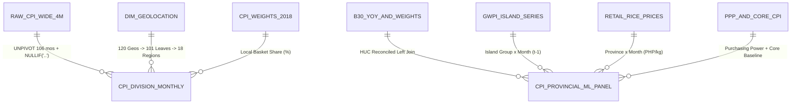

# PesoPulse: Philippine Provincial Inflation Monitor

<div align="center">


-00695c?style=for-the-badge)


**Estimating how sudden jumps in rice, electricity, and diesel prices hit ordinary and Bottom-30% low-income households next month across 101 Philippine provinces and cities (Jan 2018 to Oct 2026).**

</div>

---

## 1. Focused Stakeholder & Operational Objective

> **"How will a sudden jump in rice, electricity, or diesel prices hit ordinary and Bottom-30% low-income households in a specific province next month, and where should Local Price Coordinating Councils act first?"**

Built specifically for **DTI and Department of Agriculture Local Price Coordinating Councils (LPCCs)**, **PesoPulse** transforms `4,502,880` raw PSA OpenSTAT monthly CPI cells inside **DuckDB** into a focused decision-support platform for monthly SRP inspections, Kadiwa rolling stores, NFA rice buffer deployment, and targeted household relief.

---

## 2. Verified Philippine Government Data Sources (PSA OpenSTAT `2M`)

All datasets originate from official **Philippine Statistics Authority (PSA) OpenSTAT** tables (`openstat.psa.gov.ph`), joined deterministically by `src/duckdb_pipeline.py`:

| PSA PxWeb Table ID | Role in LPCC Analysis | Scope & Granularity |
| :--- | :--- | :--- |
| `0012M4ACP22.px` | Base monthly CPI (`2018=100`) | `120` geolocations × `354` COICOP items, `Jan 2018 – Oct 2026` (`4.50M` cells) |
| `0012M4ACP23.px` | Official Year-on-Year Inflation (`%`) | `120` geolocations × key COICOP divisions (`230,400` rows) |
| `0012M4ACP25.px` | Local `2018=100` CPI Basket Weights | Within-province expenditure shares for rice, utilities, and fuel (`42,480` rows) |
| `0022M4ABIR2.px` & `IR3.px` | Bottom-30% Household CPI & Weights | Low-income YoY inflation and staple basket shares across `120` geos (`104,760` rows) |
| `0042M4ARN01.px` | Provincial Retail Rice Prices (`PHP/kg`) | Well-milled and regular-milled retail rice series (`25,704` rows) |
| `0032M4AWPI1.px` | Island Wholesale Price Index (`GWPI`) | Upstream Luzon, Visayas, and Mindanao cost-push series (`1,296` rows) |
| `0012M4ACP24.px` & `31.px` | Purchasing Power & Core CPI | Real peso purchasing power and non-food baseline (`14,592` rows) |

* **Runtime Parquet Marts (`2.2 MB` total):** `data/cpi_provincial_ml_panel.parquet` (`10,706` rows across `101` provinces/HUCs, `55` engineered columns) and `data/cpi_division_monthly.parquet` (`254,082` unpivoted division records).
* **Strict `<1,000`-Row Hygiene:** Every visual queries DuckDB SQL aggregations over Parquet so strictly fewer than `1,000` rows reach Plotly, verifiable live inside the app's **DuckDB SQL Audit Trail**.

---

## 3. DuckDB Relational Pipeline



---

## 4. Essential Findings & Out-of-Time Benchmarks (`2025–2026` Holdout)

* **Significant Local Divergence:** Monthly inflation differs significantly across all 18 regions (`One-Way ANOVA F = 5.53`, `p < 0.001`), with outer-island markets such as Batanes (`5.25%`) and Dinagat Islands (`5.07%`) breaching `4.0%` far more frequently than NCR (`3.41%`).
* **Regressive Food Impact:** When food inflation exceeds `5%`, Bottom-30% households suffer **`+0.95 pp`** higher inflation than ordinary households (`paired t = 43.52`), driven by higher staple rice weights (e.g., `12.15%` Bottom-30% vs `4.50%` ordinary in Baguio City).
* **Blind `2025–2026` Model Evaluation (`Train: 2020–2024`):**
  * **Ordinary Household Next-Month Forecast (Ridge):** `0.93 pp` MAE, `R² = 0.874`
  * **Bottom-30% Household Next-Month Forecast (Dedicated Ridge):** Live out-of-time model trained directly on `b30_headline_yoy_pct(t+1)`
  * **`>4.0%` Price-Alert Classifier (XGBoost):** `92.6%` Accuracy, `0.976` ROC-AUC with interactive alert cutoff slider
  * **Uncertainty & Attribution:** Dynamic `3` to `12`-month SARIMAX `80%`/`95%` fan charts, Quantile GBR shock intervals, and TreeSHAP driver attribution

---

## 5. Dashboard Structure (4 Connected Views)

1. **Household Price Exposure:** 5 essential basic charts (line, histogram with Tukey fence, regional median bar, retail rice scatter, and ordinary vs. Bottom-30% basket donuts) plus ANOVA and paired $t$-test diagnostics.
2. **Provincial Hotspots & Flows:** 5 essential advanced charts (101-unit geospatial map, interactive sunburst, cost-channel Sankey, 5-axis parallel coordinates, and category contribution stream).
3. **Next-Month Forecasts & Alerts:** Dual Ridge benchmarks, dynamic SARIMAX fan chart, top-8 TreeSHAP drivers, interactive `>4.0%` ROC alert curve, and cross-filtered shock-miss inspector with one-click simulator handoff.
4. **LPCC Supply-Shock Simulator:** One-click policy presets and three core sliders (**Rice**, **Electricity & LPG**, **Diesel & Pump Fuel**) generating live next-month ML forecasts for both ordinary and Bottom-30% households, cross-province comparisons, and actionable LPCC advisories.

---

## 6. Quickstart & Cloud Deployment

```bash
pip install -r requirements.txt
streamlit run app.py
```

Pre-built ZSTD Parquet marts (`~2.2 MB`) allow instant startup on **Streamlit Community Cloud** (`Python 3.12`, main file `app.py`) with zero external raw files or secrets required.
